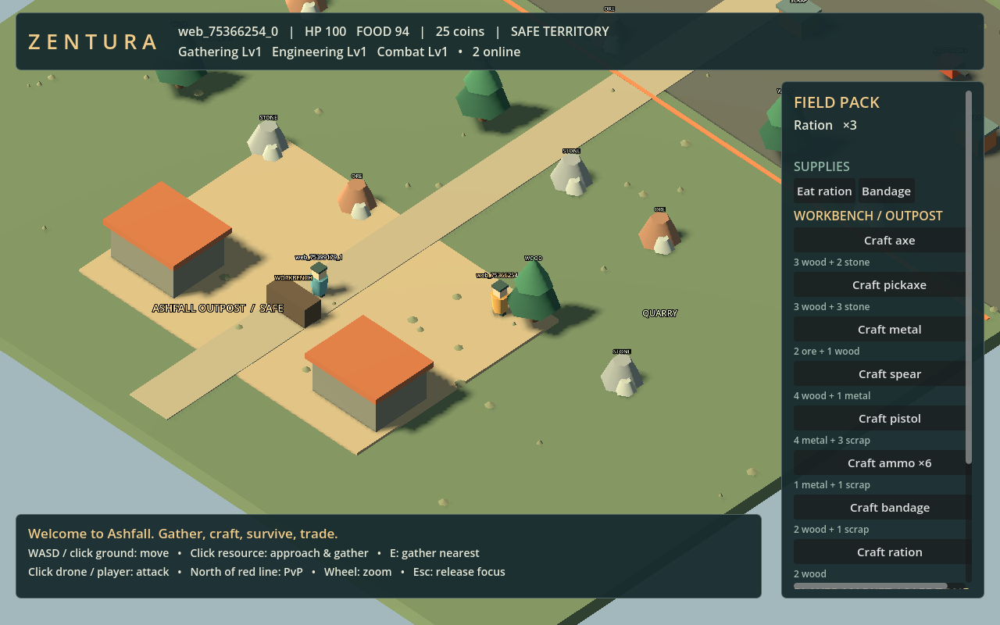

# Zentura — Ashfall Frontier

A playable, browser-exportable Godot 4 vertical slice: a low-poly isometric survival world with RuneScape-inspired gathering and Rust-inspired industrial danger. All artwork is generated from original geometric primitives; no asset packs or plugins required.

**Prototype, not a production MMO.** One shared map, up to 32 characters per server. No public server is provisioned by this repository.



## Play locally

Use **Godot 4.7.2 standard (GDScript)**, the version tested here. Compatibility renderer is already configured. Earlier Godot 4 versions are not verified.

1. Open `project.godot` in Godot and press F6/F5 (main scene).
2. For a quick single-player test, enter a name and an 8+ character passphrase, then choose **Solo field test**.
3. For shared multiplayer, start a separate server first:

```sh
godot --headless --path . -- --server --port=9080
```

4. Run two clients, using different names. Enter `ws://127.0.0.1:9080` and choose **Enter shared world**. For another computer, use the server's reachable IP address instead of `127.0.0.1`.

A new name creates an account; the same name and passphrase resumes it. Names use 3–16 letters, digits or underscores and must start with a letter. Passphrases are not stored on the client. Keep yours: there is no account recovery.

## Browser build (test this first)

Install the **matching Godot 4.7.2 export templates** through Editor → Manage Export Templates. Then:

```sh
./tools/export_web.sh
python3 -m http.server 8060 --directory build/web
```

Open `http://localhost:8060`. Start the headless server separately as above for multiplayer. The Web preset uses **single-threaded WebAssembly + WebGL 2 + Compatibility**, with no GDExtensions. Do not open the HTML directly from disk. No cross-origin isolation headers are needed for this single-threaded export. The whole `build/web` directory must be served together.

## Ten-minute loop

- **WASD** or **click ground** to move. Camera is fixed isometric and follows you; mouse wheel zooms.
- **Click a tree, rock, ore node or scrap crate** to approach and gather once. **E** gathers the nearest non-depleted resource. Each node holds five harvests and returns 30 seconds after depletion.
- Craft an **axe** or **pickaxe** for double yields, then refine **metal**, build a **spear** or **pistol**, and make **ammo** at the southern outpost workbench (within eight world units of its center).
- Recipe costs are visible below buttons. The right panel scrolls to reach trading controls. There are 12 item types and eight recipes.
- Food slowly falls. Craft/eat **rations** or use **bandages** to heal. Resting in the southern safe zone heals you.
- North of the red line, drones attack and players can damage each other. Click a drone/player within range to attack. A pistol with ammo is used automatically; otherwise a spear, then fists. Click for every attack. Drones drop scrap and coins; they respawn after 25 seconds.
- Trade one item at a time through the outpost market: set an item and coin price, post an offer, then another player buys it. The item is held in escrow. Cancel/disconnect refunds it; a server restart refunds all open listings. Purchases require the buyer to be in the southern safe zone.
- In the scrapyard, **Salvage contract** exchanges one scrap for eight coins. This provides a coin source even when playing alone.
- Death returns you to the outpost, costs up to ten coins, and retains your items/XP. This prototype does **not** use full-loot death.
- Gathering, engineering and combat earn XP. Displayed levels rise every 100 XP; levels are informational in this slice, without gated recipes or combat scaling.

## Saves and hosting

The server owns movement speed, range, cooldowns, resource depletion, inventory, recipes, damage, coins and transactions. Clients send intent, never authoritative positions or item counts. Snapshots run at 10 Hz over Godot's high-level WebSocket multiplayer. Positions are visually interpolated.

Server saves are JSON in Godot's `user://world.json`; solo uses `user://solo.json`. On Linux the default base is `~/.local/share/godot/app_userdata/Zentura • Ashfall Frontier/`. Browser solo saves use the browser's storage and may disappear when site data is cleared. Shared progress lives on the server. Autosave runs every five seconds and on joins/disconnects. A sudden crash may lose up to five seconds. Account saves include position, health, food, inventory, XP and coins; resource depletion and remaining respawn time are saved too. Drones reset on restart. Saves use temporary-file replacement; keep external backups.

Override the server file with an **absolute, writable path**:

```sh
godot --headless --path . -- --server --port=9080 --save=/srv/zentura/world.json
```

For Internet hosting:

1. Run the Godot headless process on a Linux host with the project source available; keep its save directory on persistent storage.
2. Serve `build/web` via HTTPS on your static host.
3. Reverse-proxy `/world` to the Godot server on port 9080, enabling WebSocket upgrades and long idle timeouts. Example Caddy configuration is in `docs/Caddyfile.example`.
4. Players enter `wss://YOUR_DOMAIN/world` in the client. HTTPS pages require secure `wss://`, not `ws://`.
5. Keep the backend port private when using a reverse proxy. Share the HTTPS game URL with players.

This prototype uses a salted SHA-256 passphrase digest, **not** a production password KDF. Use throwaway passphrases and TLS; do not reuse real credentials. It has no email verification, recovery, robust abuse/rate protection, sharding, spatial interest filtering, database migrations or MMO load testing. Snapshots expose public gameplay state, including inventories. Deploy only as a small trusted playtest until authentication, traffic limits and observability are hardened. JSON storage is intentional for this dependency-free first slice; SQLite was deferred.

## Verification

```sh
# Deterministic rules tests (returns nonzero on failure)
godot --headless --path . --script tests/test_world.gd

# Start a disposable server, then launch both clients concurrently in other terminals:
godot --headless --path . -- --server --save=/tmp/zentura-smoke.json
godot --headless --path . -- --bot --name=smoke_one
godot --headless --path . -- --bot --name=smoke_two
```

The built-in smoke clients travel to the same tree and gather, then exit with `NETWORK_SMOKE_PASS`. For a clean run remove the disposable save before starting the server. The clients take about 14 seconds. Use `tools/browser_smoke.cjs` with Playwright for the browser test (see its header). See `docs/VERIFICATION.md` for the actual checks performed on this initial commit.

## Scope and next steps

Implemented: small outpost/forest/quarry/scrapyard, point-and-click and keyboard movement, 3 XP tracks, gathering, eight recipes, tools, melee/ranged combat, dangerous PvP zone, PvE drones, survival supplies, coins, atomic one-item player listings and persistence.

Next: password KDF/auth service, inventory privacy, per-peer traffic limits, better movement/interaction feedback, audio, obstacles/navigation, equipment selection, bank/storage, SQLite transactions and backups, map expansion and performance tests. Buildings are scenery; movement is bounded but currently passes through scenery. No construction, guilds, quests, firearms aiming, full-loot rules, or large-population MMO features are claimed.

## License

MIT. See `LICENSE`.
